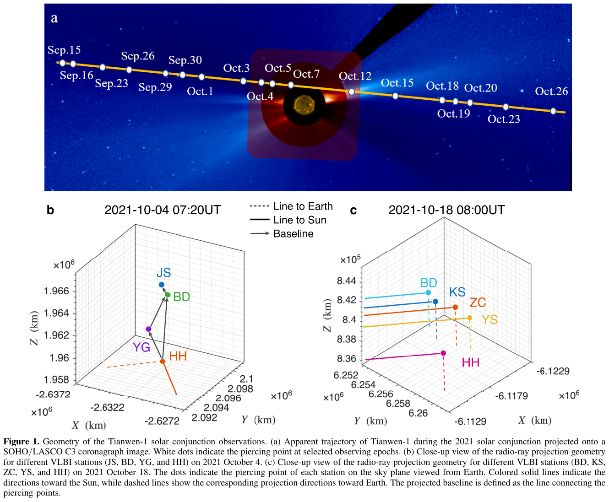
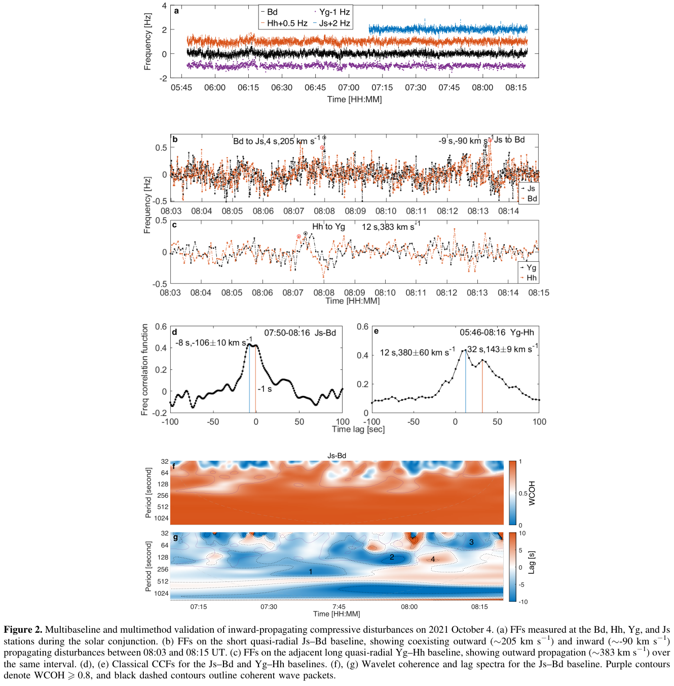
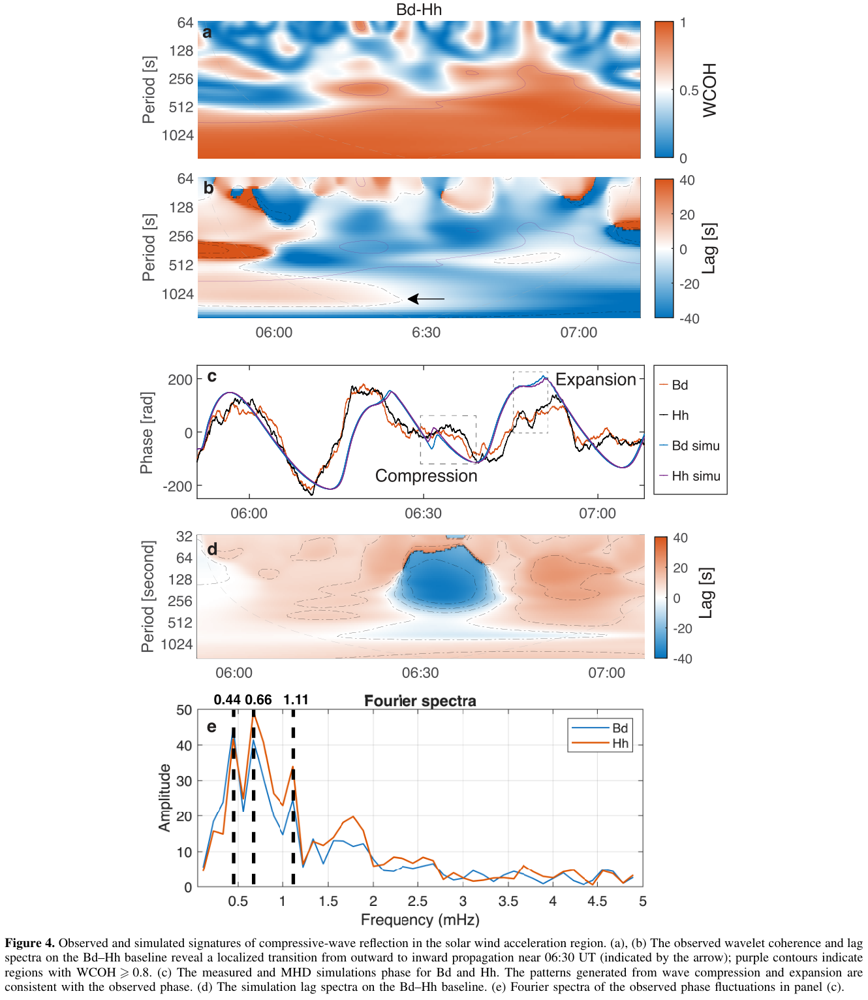
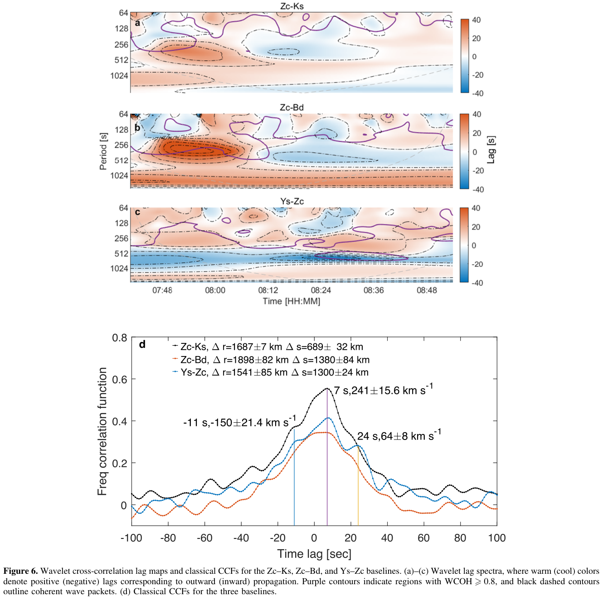

# Compressive-wave propagation and reflection with Tianwen-1

Python research code for studying electron-density fluctuations in the solar wind acceleration region using coordinated Tianwen-1 radio sounding and multiple ground-based radio telescopes during the 2021 solar conjunction. Wavelet coherence, time-lag analysis, projected baseline geometry, and multibaseline fitting connect the observed fluctuations to inward and outward propagation. The case catalog also retains selected 2023 comparison observations.

Associated article: **Maoli Ma et al., “Spatially Inferred Signatures of Compressive Wave Reflection in the Solar Wind Acceleration Region,” The Astrophysical Journal 1012, 116 (2026).** [Open-access PDF](paper/Ma_et_al_2026_ApJ_1012_116.pdf) · [DOI: 10.3847/1538-4357/aeb6b6](https://doi.org/10.3847/1538-4357/aeb6b6). This repository contains the observational analysis maintained by Rui Zhuo and related exploratory tools; the paper's MHD solver is not included.

## Scientific workflow

1. **Select observations and geometry.** Choose the observing date, station pair, processing variant, and UTC interval from the case catalog. Calculate solar offsets and sky-plane baseline projections using station coordinates and SPICE ephemerides.
2. **Prepare radio fluctuations.** Read frequency or phase products, apply the declared time convention and station polarity, remove outliers and trends, and interpolate/filter according to the workflow's cadence settings.
3. **Measure scale-dependent lags.** Calculate wavelet coherence and phase-derived time lags, and reconstruct selected temporal bands. Inspect coherence, lag sign, and station ordering before converting a lag and projected separation into a baseline propagation speed.
4. **Combine baselines and estimate fluctuations.** Fit a two-dimensional propagation direction and speed where corresponding structures can be identified across three baselines. Examine residuals and geometry, compare spectral slopes, and estimate density-fluctuation amplitudes using the stated line-of-sight assumptions.
5. **Interpret inward and outward components.** Compare events, scales, and heliocentric distances. The article combines observational signatures with independent MHD simulations to assess compressive-wave reflection; the current analysis snapshot is not an automatic end-to-end reproduction of every published panel.

### Key published results

The following four figures are extracted from the final article, with their original captions. They are published reference results, not newly generated outputs; see [figure provenance and attribution](figures/README.md).

**Figure 1 — Observation geometry.** The solar-conjunction trajectory and projected station baselines establish where the radio rays sample the corona.



**Figure 2 — Inward propagation on 4 October 2021.** Multistation series, classical correlations, and wavelet diagnostics provide complementary evidence for counter-propagating disturbances.



**Figure 4 — Reflection signatures.** Observed and simulated coherence, lag, and phase structures are compared in the paper. The simulation portion comes from the separate MHD work.



**Figure 6 — Independent baseline comparisons.** Wavelet lag maps and classical cross correlations compare the Zc–Ks, Zc–Bd, and Ys–Zc baselines.



## Repository layout

```text
Fluc_propagation_by_TW1_2021/       # Local analysis checkout: CODE/
├── run_analysis.py               # Common command-line entry point
├── analyse_*.py, calc_*.py        # Analysis entry points and geometry
├── plot_*.py, reconstruct_*.py    # Visualization and reconstruction
├── statisticize_*.py             # Cross-event summaries
├── tw1/                          # Shared implementation
│   ├── cases.json                # 59 workflow-specific presets
│   ├── paths.py, cases.py        # Paths, configuration and validation
│   ├── time.py, io.py, signal.py # Input and preprocessing helpers
│   ├── density.py, propagation.py
│   └── workflows/               # 11 callable analysis workflows
├── Sun_Mars_Earth/               # Geometry code, coordinates and assets
│   └── kernels/                 # SPICE kernels; de430.bsp is external
├── figures/                     # Four published figures and attribution
├── paper/                       # Final open-access article PDF
├── references/paper.bib          # Full article citation
├── CITATION.cff                  # GitHub citation metadata
├── requirements.txt             # Direct Python dependencies
├── test_*.py                     # Existing regression checks
├── MULTIBASELINE_METHOD.md       # Fit model and uncertainty details
└── docs/                        # Data contracts and Chinese usage notes
```

The local research layout has sibling `CODE/`, `RESULT/`, and `PAPER/` directories. A clone can be named `CODE` to reproduce this arrangement; paths are resolved from source location, not the shell's working directory. Raw observations, result workbooks, full output archives, manuscript drafts, review notes, and caches are not part of this release. Existing geometry assets and the historical `best_model.pkl` are retained; the maintained Python scripts do not reference that model file.

## Requirements

- Python 3.10 or newer (`argparse.BooleanOptionalAction` is used).
- NumPy, SciPy, pandas, Matplotlib, Pyleoclim, Plotly, PyWavelets, Astropy, SpiceyPy, and openpyxl. Jupyter is optional for the exploratory notebook.
- External `python_utils_JSHEPT.py` for wavelet reconstruction, reconstruction plotting, and spectral-index workflows; set `TW1_UTILS_DIR` to its directory. This utility is not bundled.
- SPICE `de430.bsp`, in addition to the kernels retained in `Sun_Mars_Earth/kernels/`, for geometry calculations. Obtain kernels from [NASA NAIF](https://naif.jpl.nasa.gov/pub/naif/generic_kernels/); the code names the exact historical kernels in `calc_solar_offset.load_kernels`.
- MATLAB with `readmatrix` support (R2019a+) only for the two optional `.m` helpers. The main pipeline is Python.

```powershell
python -m venv .venv
.venv/Scripts/Activate.ps1
python -m pip install -r requirements.txt
```

`requirements.txt` lists direct dependencies, not a reproducibility lockfile. The existing local environment reports NumPy 1.26.4, SciPy 1.9.1, pandas 2.1.4, Matplotlib 3.10.8, Pyleoclim 1.1.0, Plotly 5.18.0, PyWavelets 1.4.1, Astropy 5.1.1, SpiceyPy 5.1.2, and openpyxl 3.1.2. SciPy 1.9.1 declares NumPy <1.25, so this local combination has a known dependency warning and should not be treated as a recommended pinned environment. A clean environment has not been validated by this publication cleanup.

## Data and configuration

The paper identifies two public archives: [cross-correlation code and lag-analysis data, Zenodo 21369407](https://doi.org/10.5281/zenodo.21369407), and [MHD simulation data, Zenodo 19362826](https://doi.org/10.5281/zenodo.19362826). These links are transcribed from the final paper; the archive contents have not been checked for one-to-one compatibility with the current 59-preset catalog.

Set `TW1_DATA_DIR` to the parent containing the `2021/` and `2023/` observation directories, and `TW1_UTILS_DIR` to the external wavelet utility directory. Defaults preserve the author's local `E:/Research/Data/Tianwen-1` and `E:/Research/Program/[else]` paths. Results are read/written in `../RESULT` relative to the repository root.

```powershell
$env:TW1_DATA_DIR = 'D:/data/Tianwen-1'
$env:TW1_UTILS_DIR = 'D:/research-utils'
python run_analysis.py --list
python run_analysis.py analyse_wavelet_coherence --list
python run_analysis.py analyse_wavelet_coherence --case 9 --check
python run_analysis.py analyse_wavelet_coherence --case 9 --start 08:00 --end 08:20 --no-save --plot 1
python analyse_multiple_baseline.py --no-show
```

`tw1/cases.json` declares exact filenames, processing directories, UTC bounds, `utc_code` versus seconds-of-day time formats, and frequency-sign corrections. Do not replace `outdated` or `[phase]` inputs with a different processing variant. Short time overrides inherit the case date; selection uses open endpoints and is limited to a single UTC day. `--save/--no-save` controls existing save branches, while `--show/--no-show` controls windows; multi-baseline scripts have their own options and always export their fit products.

The full `--check` and parts of `test_local_structure.py` require the local observations. Workbooks such as `wavelet_coherence.xlsx` and `multiple_baseline.xlsx` are separate analysis inputs, not downloaded by the scripts. See [data contracts and reproducibility limits](docs/DATA_AND_REPRODUCIBILITY.md) and [Chinese local usage notes](docs/LOCAL_WORKFLOW_ZH.md).

```powershell
python -m unittest test_multibaseline_fit -v
# With the complete observation archive:
python run_analysis.py --check
python -m unittest discover -s . -p 'test_*.py' -v
```

## Code functionality

Release checks: **14 existing regression tests passed**, and all 59 preset selections passed the local input check. Source syntax, documentation links, and the copied PDF were also checked; see [validation details and limitations](docs/RELEASE_VALIDATION.md).

### Workflow entry points and implementations

Each entry point below delegates to the linked `tw1/workflows` implementation. The two files share one workflow; the entry point preserves the historical command name and the implementation exposes `main()` for Python use.

| Entry point / implementation | Functionality |
| --- | --- |
| [analyse_wavelet_coherence.py](analyse_wavelet_coherence.py) / [implementation](tw1/workflows/analyse_wavelet_coherence.py) | Reads paired frequency residuals, removes outliers and trends, and calculates wavelet coherence and scale-dependent time lag. It returns the paired series and lag diagnostics and optionally saves plots for the chosen station pair. |
| [analyse_wavelet_coherence_for_phase.py](analyse_wavelet_coherence_for_phase.py) / [implementation](tw1/workflows/analyse_wavelet_coherence_for_phase.py) | Analyzes paired phase series with the phase-specific preprocessing and wavelet settings. It plots coherence and lag maps to compare propagation across temporal scales. |
| [analyse_wavelet_coherence_for_PLL.py](analyse_wavelet_coherence_for_PLL.py) / [implementation](tw1/workflows/analyse_wavelet_coherence_for_PLL.py) | Analyzes higher-cadence phase-locked-loop products for a selected station pair. It supports Matplotlib or Plotly diagnostics and preserves the PLL-specific sampling treatment. |
| [reconstruct_wavelet.py](reconstruct_wavelet.py) / [implementation](tw1/workflows/reconstruct_wavelet.py) | Reconstructs paired fluctuations in selected wavelet-period bands. It returns reconstructed components for comparison with the original series and requires the external JSHEPT wavelet utility. |
| [calc_power_index.py](calc_power_index.py) / [implementation](tw1/workflows/calc_power_index.py) | Calculates wavelet power and fits spectral slopes over configured time and frequency intervals. It compares station spectra and requires the external JSHEPT wavelet utility. |
| [calc_density_fluctuation.py](calc_density_fluctuation.py) / [implementation](tw1/workflows/calc_density_fluctuation.py) | Estimates electron-density fluctuation amplitudes from a frequency-fluctuation spectrum and line-of-sight assumptions. It retains the original example interval, density model, and integration conventions. |
| [plot_wavelet_spectrum.py](plot_wavelet_spectrum.py) / [implementation](tw1/workflows/plot_wavelet_spectrum.py) | Displays a single-station time series and continuous-wavelet power using PyWavelets. It provides frequency/phase spectral diagnostics with the original sample-selection settings. |
| [plot_wavelet_reconstruction.py](plot_wavelet_reconstruction.py) / [implementation](tw1/workflows/plot_wavelet_reconstruction.py) | Compares selected station series and their reconstructed wavelet-band components in a multi-panel plot. It uses fixed station selections and the external JSHEPT wavelet utility. |
| [plot_density_fluctuation.py](plot_density_fluctuation.py) / [implementation](tw1/workflows/plot_density_fluctuation.py) | Reads the density_fluc sheet of multiple_baseline.xlsx and compares peak and integral estimates of density fluctuations. It plots their dependence on heliocentric distance and related physical quantities. |
| [statisticize_wavelet_coherence.py](statisticize_wavelet_coherence.py) / [implementation](tw1/workflows/statisticize_wavelet_coherence.py) | Reads the distribution and coherency sheets of wavelet_coherence.xlsx. It summarizes propagation speed against solar offset, scale, and observing geometry. |
| [statisticize_wavelet_coherence_inward.py](statisticize_wavelet_coherence_inward.py) / [implementation](tw1/workflows/statisticize_wavelet_coherence_inward.py) | Reads the same coherence workbook to inspect inward-propagating cases. It plots the relationship between baseline geometry and signed propagation speed. |

### Additional scripts and compatibility helpers

| File | Functionality |
| --- | --- |
| [run_analysis.py](run_analysis.py) | Provides the common command-line entry point for workflow discovery, case listing, and input checks. It delegates execution to tw1.cli without duplicating scientific calculations. |
| [analyse_multiple_baseline.py](analyse_multiple_baseline.py) | Fits a two-dimensional sky-plane propagation velocity from three baseline measurements in multiple_baseline.xlsx. It exports RMSE maps, sky-plane plots, and summary tables under RESULT/multiple_baseline_rmse, with zoom-in and zoom-out modes. |
| [analyse_multiple_baseline_for_spikes.py](analyse_multiple_baseline_for_spikes.py) | Fits the selected spike-like event from the whitespace-delimited baseline lag table. It writes corresponding fit diagnostics and summaries to RESULT/multiple_baseline_rmse/spikes. |
| [plot_2d_propagation_composite.py](plot_2d_propagation_composite.py) | Combines station geometry, coherence measurements, and fitted velocity summaries into a publication-style composite. It writes to the historical sibling PAPER/Figures/2Dpropagation(6).png path, whose parent directory must already exist. |
| [calc_solar_offset.py](calc_solar_offset.py) | Uses SPICE ephemerides and station coordinates to construct Sun–Mars–Earth geometry. It computes projected station positions, baseline components, and solar offsets; kernels are loaded when geometry is calculated. |
| [read_PLL_data.py](read_PLL_data.py) | Converts the selected Fre_Pha_data array in a Time_Frequency_Phase.mat file to a text observation product. It accepts observation, station, channel, and output arguments; an explicit output avoids writing into the observation archive. |
| [project_paths.py](project_paths.py) | Re-exports the path helpers in tw1.paths for historical imports. It keeps legacy scripts connected to the same data, geometry, and result locations. |
| [utils_signal_analyse.py](utils_signal_analyse.py) | Re-exports shared time and signal-processing helpers. It preserves the old import interface while implementations live in tw1.time and tw1.signal. |
| [multibaseline_fit.py](multibaseline_fit.py) | Re-exports the fitting and diagnostic functions from tw1.propagation. It preserves the historical import interface used by both multibaseline scripts. |
| [Sun_Mars_Earth/main.py](Sun_Mars_Earth/main.py) | Builds three-dimensional Sun–Mars–Earth and station geometry visualizations with Matplotlib. It uses the bundled coordinate table and externally completed SPICE kernel set. |
| [Sun_Mars_Earth/plotly_ver.py](Sun_Mars_Earth/plotly_ver.py) | Provides interactive Plotly views of the planetary and station geometry. It uses local planet textures and topographic assets retained in Sun_Mars_Earth. |
| [Sun_Mars_Earth/calc_coordinate.m](Sun_Mars_Earth/calc_coordinate.m) | Converts a manually selected longitude and latitude to Cartesian coordinates on a spherical Earth. It prints the resulting coordinates in metres for the chosen station. |
| [Sun_Mars_Earth/calculate_wave_vector.m](Sun_Mars_Earth/calculate_wave_vector.m) | Reads RESULT/base_line_multiple/cases.xlsx to combine propagation speed, temporal scale, and direction. It calculates wavelengths and Cartesian wavevector components in the selected geometry. |
| [calc_density_fluctuation.ipynb](calc_density_fluctuation.ipynb) | Retains the exploratory density-calculation notebook and its historical outputs. The maintained script entry point is calc_density_fluctuation.py; notebook outputs are not evidence of a fresh reproduction. |
| [test_local_structure.py](test_local_structure.py) | Checks observation-path mapping, case selection, UTC windows, import behavior, and shared helper behavior. Several tests require the exact local observation archive, so this is not a data-free CI suite. |
| [test_multibaseline_fit.py](test_multibaseline_fit.py) | Exercises signed plane-wave recovery, rotation and scaling, invalid inputs, and fit diagnostics using synthetic inputs. It checks the velocity-fitting implementation without requiring mission observations. |

### Shared package

| File | Functionality |
| --- | --- |
| [tw1/__init__.py](tw1/__init__.py) | Defines the analysis package. Importing it does not launch a workflow. |
| [tw1/paths.py](tw1/paths.py) | Resolves source-relative project and result directories and environment-configured data and utility roots. It maps observation IDs to year directories while retaining explicit processing variants. |
| [tw1/cases.py](tw1/cases.py) | Loads the JSON catalog and constructs validated observation selections. Temporary time and filename overrides leave the stored presets unchanged. |
| [tw1/time.py](tw1/time.py) | Converts encoded UTC times and seconds of day and constructs analysis windows. Windows retain open endpoints and support same-day overrides. |
| [tw1/io.py](tw1/io.py) | Reads station time series with explicit time conventions and frequency polarity. It also converts selected PLL MAT arrays to text. |
| [tw1/signal.py](tw1/signal.py) | Implements outlier removal, interpolation, polynomial detrending, and log-linear spectral fitting. These functions support the shared preprocessing used by the workflows. |
| [tw1/density.py](tw1/density.py) | Collects the line-of-sight, background-density, fluctuation-amplitude, and spectral-integration functions. It also provides the retained diagnostic fitting and detrending plots. |
| [tw1/propagation.py](tw1/propagation.py) | Fits the plane-wave baseline model v_i = V / cos(theta - phi_i) with signed measurements and reports residuals and conditional uncertainty estimates. It exports loss surfaces and tabular diagnostics; see MULTIBASELINE_METHOD.md for assumptions and uncertainty limits. |
| [tw1/cli.py](tw1/cli.py) | Parses workflow, case, UTC-window, plotting, and saving options. It validates supported combinations and dispatches to the appropriate implementation. |
| [tw1/workflows/__init__.py](tw1/workflows/__init__.py) | Defines the workflow subpackage. Workflow modules expose callable main functions and defer analysis until invoked. |

## Related publication and citation

[Public repository PDF](paper/Ma_et_al_2026_ApJ_1012_116.pdf) · [Publisher PDF](https://iopscience.iop.org/article/10.3847/1538-4357/aeb6b6/pdf) · [DOI](https://doi.org/10.3847/1538-4357/aeb6b6) · [BibTeX file](references/paper.bib) · [GitHub citation metadata](CITATION.cff)

Please cite the article when using this work. The first four authors contributed equally, as noted in the publication.

**MLA**

Ma, Maoli, et al. “Spatially Inferred Signatures of Compressive Wave Reflection in the Solar Wind Acceleration Region.” *The Astrophysical Journal*, vol. 1012, 2026, article 116. https://doi.org/10.3847/1538-4357/aeb6b6.

**BibTeX**

```bibtex
@article{Ma2026Reflection,
  author = {Ma, Maoli and Zhuo, Rui and Yuan, Liangliang and Wu, Ziqi and He, Jiansen and Li, Peijia and Molera Calvés, G. and Xiong, Ming and Kong, Jing and Jin, Wenma and Liu, Qinghui and Hou, Yubo and Chen, Zhong and Xia, Bo and Wu, De and Chu, Zhanghu and Edwards, Jasper and Cimò, Giuseppe and Quick, Jonathan and Kharinov, Mikhail and Mikhailov, Andrey and Zhang, Hua and Hao, Longfei and Gonzòlez, Javier J. and Morsiani, Marco and Neidhardt, Alexander},
  title = {Spatially Inferred Signatures of Compressive Wave Reflection in the Solar Wind Acceleration Region},
  journal = {The Astrophysical Journal},
  volume = {1012},
  pages = {116},
  year = {2026},
  doi = {10.3847/1538-4357/aeb6b6},
  url = {https://doi.org/10.3847/1538-4357/aeb6b6}
}
```

The article and extracted figures are © 2026 the authors, distributed under [CC BY 4.0](https://creativecommons.org/licenses/by/4.0/). Attribution is supplied above and in the figure directory. No software license has been assigned in this repository; the article's license does not automatically license the source code or third-party assets.

## Acknowledgments

We acknowledge the Tianwen-1 mission and the participating radio observatories in China, Africa, Russia, Europe, and Australia for enabling coordinated observations. The article thanks Dali Kong and Jinhan Xie for discussions; Weimin Zheng and Fengchun Shu for observational support; Yong Huang for spacecraft dynamic modeling; and Xu Zhao, Lei Liu, and Juan Zhang for data-decoding assistance.

The published work acknowledges NSFC grants 42241118, 12273098, and 42504171; Shanghai grants 24YF2754300 and 24PJA152; the Shanghai Astronomical Observatory Key Incubation Project; the CAS Key Laboratory of Radio Astronomy and Technology; and additional support for Liangliang Yuan from the CAS Pioneer Hundred Talents Program and CAS project YSBR-136. We also acknowledge the scientific Python ecosystem and NASA NAIF SPICE used by these analysis tools.
